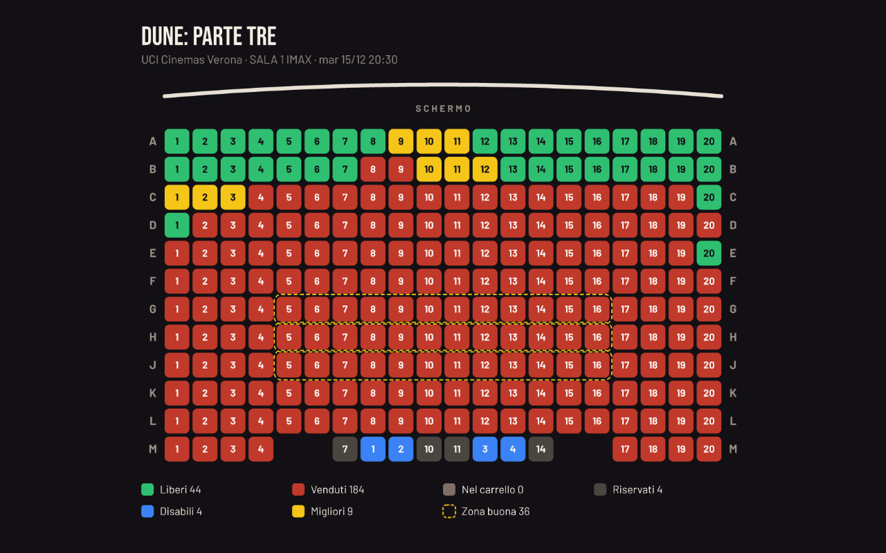
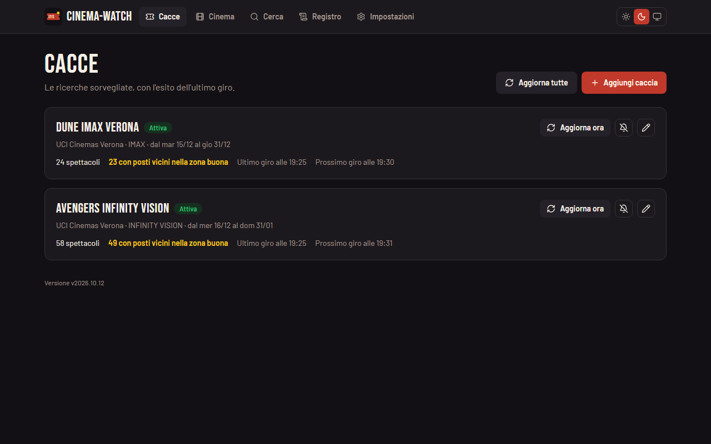
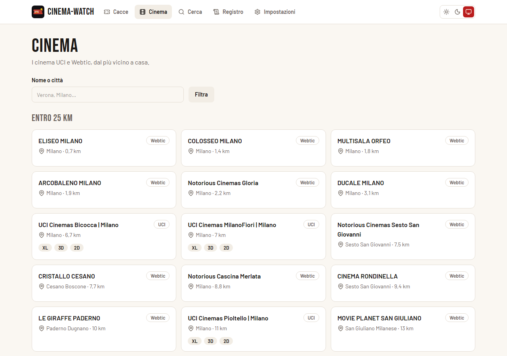

<p align="center"></p>

<h1 align="center">Cinema Watch</h1>

<p align="center">Hunts for Italian cinema tickets, with Telegram alerts and the seat map of the hall.</p>

<p align="center"><a href="README.it.md">Italiano</a></p>

<p align="center">
  <a href="https://github.com/PilaScat/cinema-watch/releases/latest"></a>
  <a href="https://github.com/PilaScat/cinema-watch/actions/workflows/ci.yml"></a>
  <a href="LICENSE"></a>
  <a href="https://github.com/PilaScat/cinema-watch/commits/main"></a>
  <br>
  <a href="https://github.com/PilaScat/cinema-watch/pkgs/container/cinema-watch"></a>
  <a href="https://github.com/PilaScat/cinema-watch/pkgs/container/cinema-watch"></a>
  <a href="https://github.com/PilaScat/cinema-watch/pkgs/container/cinema-watch"></a>
  <a href="https://ca.unraid.net/apps/cinema-watch-135myu911wky8l"></a>
  <br>
  <a href="https://scorecard.dev/viewer/?uri=github.com/PilaScat/cinema-watch"></a>
  <a href="https://www.bestpractices.dev/projects/15670"></a>
  <a href="https://github.com/sponsors/PilaScat"></a>
  <a href="https://github.com/PilaScat/cinema-watch/stargazers"></a>
</p>

## What it does

- **Hunts**: a film (even one not yet showing, searched by title), one or more cinemas, the hall formats (IMAX, XL, Infinity Vision…) and the dates, with optional filters for time (also different for each day of the week), days of the week and language.
- **Telegram alerts**: new showings, freed seats, last seats, cancelled or moved showings, with the seat map of the hall and the best free seats.
- **Good zone**: the rows and seats that suit, relative to the hall or fixed by clicking on the seat map, with the number of seats together required.
- **Buttons in the message**: Buy, Open hall, Refresh now, Mute for 24 h and Bought, with Resume and Restore to go back; `/refresh` rereads all the hunts.
- **Cinemas**: UCI Cinemas, the 35 The Space Cinema, about 300 cinemas that sell with Webtic (Notorious, Cinelandia, Movie Planet and many independents) and the 18Tickets cinemas, sortable by distance from home; a missing 18Tickets cinema is added in Settings.
- **Web UI**: hunts, programme, showing page with the live seat map and the trend of the seats, search for a film even with a typo; it installs as an app behind HTTPS.

<p align="center">
  
  
  
</p>

<p align="center">The seat map on Telegram, the hunts and the cinemas by distance from a sample home in Milan.</p>

## Stack

- Node 24 and TypeScript
- Hono, with server-side JSX
- Tailwind v4, compiled at build time
- resvg for the seat map PNGs
- zod to validate the configuration and the API responses
- data in JSON and JSONL files, no database
- image `ghcr.io/pilascat/cinema-watch` for amd64 and arm64, about 157 MB, user 99:100, compatible with `--read-only`; at rest the process uses about 50 MiB of its own memory (measured on Unraid on 18/10/2026; `docker stats` shows more because it also counts the file cache)

## Quick start

### On Unraid

1. Open the **Apps** tab, search for `cinema-watch` and press **Install**.
2. The template already proposes the data folder `/mnt/user/appdata/cinema-watch` and `PUID` 99 / `PGID` 100: just press **Apply**.

The details (path, owner, network) are in [docs/operations.md](docs/operations.md#deploy-on-unraid).

### With Docker

```sh
docker run -d --name cinema-watch \
  -p 8790:8790 \
  -v /percorso/dati:/data \
  -e PUID=1000 -e PGID=1000 \
  --read-only --tmpfs /tmp \
  --security-opt=no-new-privileges \
  --restart unless-stopped \
  ghcr.io/pilascat/cinema-watch:latest
```

`PUID` and `PGID` are the user and the group that own the data folder (`id` shows them; on Unraid 99 and 100). At start-up the container gives them the folder and runs the app as that user, so no manual `chown` is needed.

### With Docker Compose

The [docker-compose.yml](docker-compose.yml) file is an example with the same options, with the data in `./data`:

```sh
mkdir cinema-watch && cd cinema-watch
wget https://raw.githubusercontent.com/PilaScat/cinema-watch/main/docker-compose.yml
docker compose up -d
```

If `id` does not give 1000, change `PUID` and `PGID` in the file before starting.

### First steps

1. Open `http://IP:8790`. Without `UI_PASSWORD` the app answers only on an IP, on `localhost`, on a local network name or on the public URL in Settings.
2. In Settings, Telegram section, enter the bot token and the main chat ([how to get them](docs/telegram.md)), save and press Send test.
3. Press Add hunt and fill in film, cinemas, formats and dates.
4. Optional: in Settings, Home and distance section, set the home position ("lat, lon" from Google Maps, or "Use my position" by opening the app over HTTPS) and a maximum radius. Cinemas, search and the choice of cinemas in the hunts are then sorted by distance.

### Local development

```sh
npm ci
npm run build
DATA_DIR=./data node dist/server.js
```

The four checks to pass before handing in:

```sh
npm test
npx tsc --noEmit
npm run lint
npm run build
```

Other commands:

- `node dist/server.js --dry-run` runs one round against the real APIs. Messages and seat maps end up in `DATA_DIR/dry-run` and nothing is sent to Telegram.
- `sh scripts/smoke.sh` tests the container: image, read-only start, `PUID`/`PGID`, routes, permissions, stop, dry round. The details are in [docs/operations.md](docs/operations.md#smoke-test).

## Release and deploy

A release is an annotated tag `vAAAA.MM.N`, which starts `release.yml`: verification, scan, amd64 and arm64 images, attestation and a GitHub Release. On Unraid it is installed with the template [cinema-watch.xml](https://github.com/PilaScat/unraid-templates/blob/main/cinema-watch/cinema-watch.xml) of the [unraid-templates](https://github.com/PilaScat/unraid-templates) repo. All the steps are in [docs/operations.md](docs/operations.md).

## Environment variables

| Variable | Default | Meaning |
|---|---|---|
| `PUID` | `99` | User that owns the data folder and runs the app. |
| `PGID` | `100` | Group that owns the data folder and runs the app. |
| `PORT` | `8790` | Port of the web UI. |
| `DATA_DIR` | `/data` | Folder for configuration, state, seat maps, trend and log. |
| `UI_PASSWORD` | empty | Password of the web UI. Empty: no password, and whoever reaches the port reads and changes the bot token. It must be set if the port is reachable from outside the home network. |
| `TRUST_PROXY` | empty | With `1` the app takes the client IP from the last value of `X-Forwarded-For`, the one added by the proxy, for the lockout of login attempts. Needed only with the password, behind a reverse proxy. |
| `TELEGRAM_TOKEN` | empty | Bot token. Used only if the field in Settings is empty. |
| `TELEGRAM_CHAT_ID` | empty | Main chat. Used only if the field in Settings is empty. |

Settings shows when the token or the chat come from the environment.

## Limits

- It works with UCI Cinemas, The Space Cinema and the cinemas that sell tickets with Webtic or 18Tickets; other circuits do not.
- The 18Tickets cinemas have no coordinates and go to the end of the order by distance.
- The list of Webtic cinemas is updated with a weekly check: at the first start it completes in about half an hour.
- The APIs used are public but unofficial and can change without notice.
- Seats are read without a login.
- Buying stays manual: the UCI login has Cloudflare and a captcha, Webtic, The Space and 18Tickets ask for an account, and the app does not touch them.

## Documentation

| File | Topic |
|---|---|
| [docs/MEMORY.md](docs/MEMORY.md) | Decisions and pitfalls of the project. |
| [docs/api.md](docs/api.md) | UCI and Webtic APIs used, APIs exposed by the app. |
| [docs/telegram.md](docs/telegram.md) | Bot, chat, alerts, buttons and sending limits. |
| [docs/homepage.md](docs/homepage.md) | Widget for gethomepage. |
| [docs/operations.md](docs/operations.md) | Deploy, updates, backup, release and smoke test. |
| [docs/UI-COPY.md](docs/UI-COPY.md) | Rules for the visible texts. |
| [docs/backlog.md](docs/backlog.md) | What is left to decide or to do in the next releases. |
| [docs/best-practices.md](docs/best-practices.md) | Answers to the OpenSSF Best Practices questionnaire. |
| [CHANGELOG.md](CHANGELOG.md) | Notes of each version. |
| [SECURITY.md](SECURITY.md) | How to report a vulnerability. |
| [CONTRIBUTING.md](CONTRIBUTING.md) | How to report a problem and propose a change. |

## Contributing

Bugs and proposals are opened as issues; vulnerabilities are reported in private as [SECURITY.md](SECURITY.md) explains. How to prepare a pull request and which checks it must pass is in [CONTRIBUTING.md](CONTRIBUTING.md).

## License and credits

MIT license, see [LICENSE](LICENSE); the notes on third-party parts are in [NOTICE](NOTICE). Author: Filippo Scatigna (PilaScat).

- [KiraPC/italian-cinema-mcp](https://github.com/KiraPC/italian-cinema-mcp) (MIT): the UCI programme API comes from here.
- Bebas Neue and Barlow fonts (OFL).
- Lucide icons (ISC).

Not affiliated with UCI Cinemas, Webtic or the cinemas listed.
