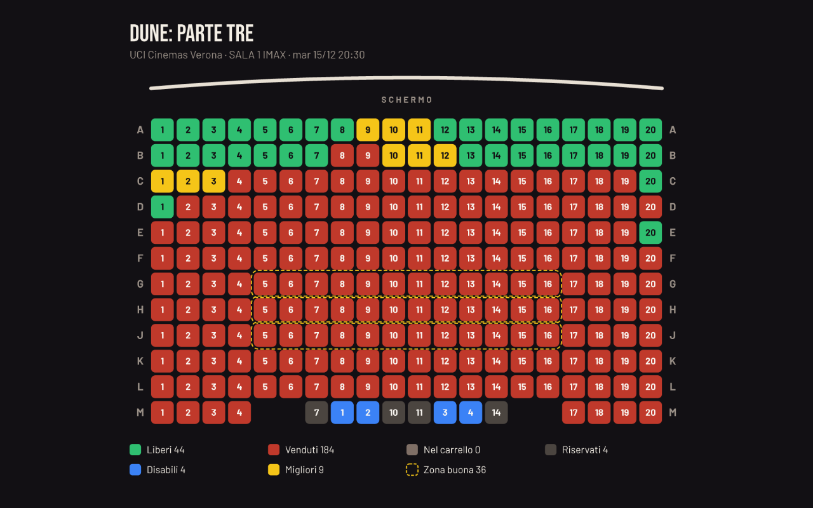
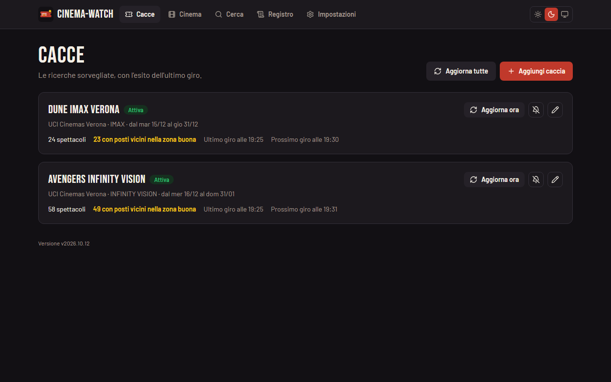
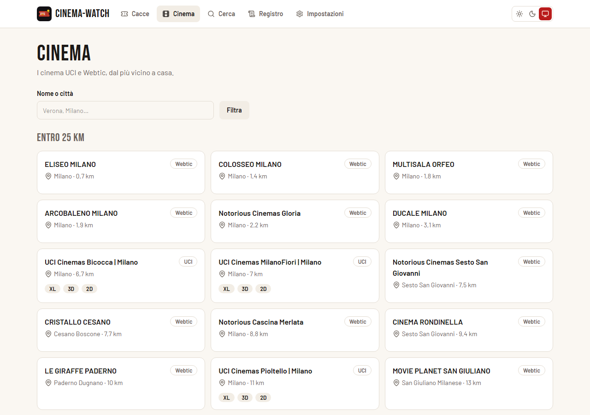
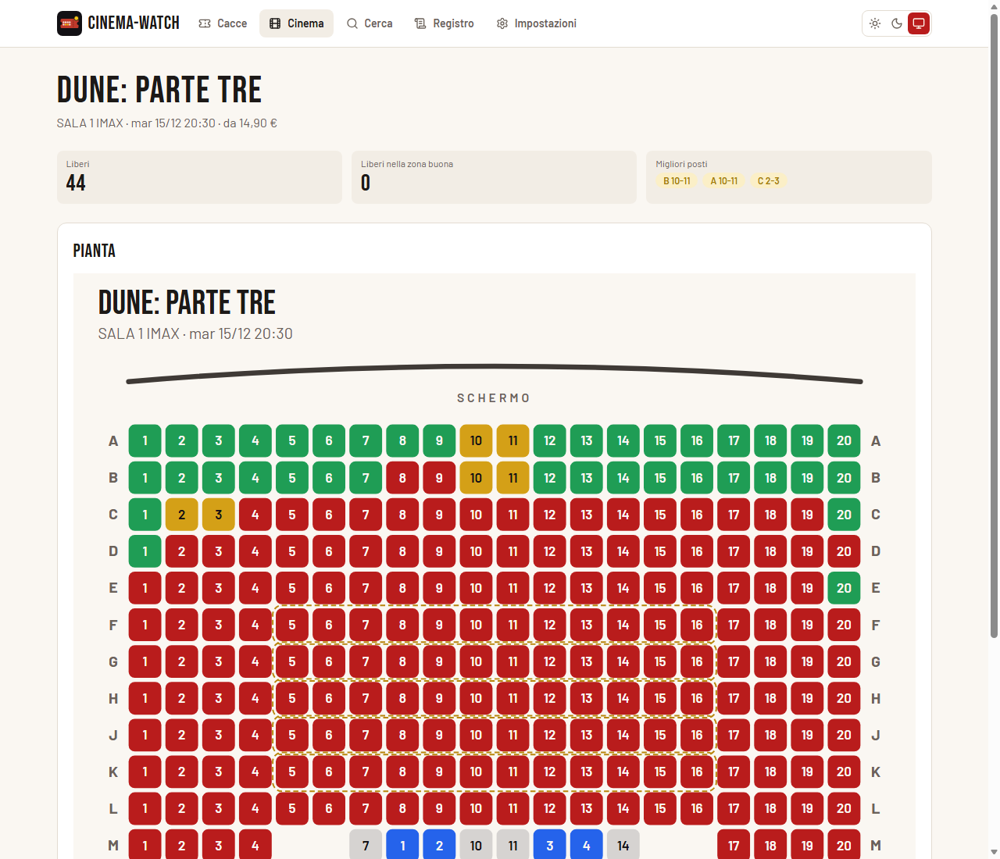

# cinema-watch

Sorveglia la programmazione dei cinema italiani con "cacce" a film, cinema, formati di sala e date. Manda su Telegram, con la pianta della sala, un avviso quando escono gli spettacoli, quando si liberano o finiscono i posti buoni e quando uno spettacolo è annullato o spostato. Una web UI leggera gestisce le cacce. Oggi copre UCI Cinemas, The Space Cinema e circa 300 cinema che vendono con Webtic (Notorious, Cinelandia, Movie Planet e molti indipendenti); gli altri circuiti sono nel [backlog](docs/backlog.md).

[](https://scorecard.dev/viewer/?uri=github.com/PilaScat/cinema-watch) [](https://www.bestpractices.dev/projects/15670)

**In English.** cinema-watch watches the programming of Italian cinemas with "hunts" for a film, a set of cinemas, screen formats and dates. It currently covers UCI Cinemas, The Space Cinema and about 300 cinemas that sell tickets through Webtic, such as Notorious; other chains are planned. When showings come out, good seats free up or run out, or a showing is cancelled or moved, it sends a Telegram alert with the seat map. It runs as a small Docker container (`ghcr.io/pilascat/cinema-watch`, amd64 and arm64) with a web UI to manage the hunts: the `docker run` command is under [Avvio rapido](#avvio-rapido). The interface and the docs are in Italian; issues and pull requests in English are welcome.

## Cosa fa

- **Cacce**: un film (anche non ancora in programmazione, cercato per titolo), uno o più cinema, i formati di sala (IMAX, XL, Infinity Vision…) e le date, con filtri facoltativi per orario, giorni della settimana e lingua.
- **Avvisi su Telegram**: nuovi spettacoli, posti liberati, ultimi posti, spettacoli annullati o spostati, con la pianta della sala e i migliori posti liberi.
- **Zona buona**: le file e i posti che vanno bene, relativi alla sala o fissati cliccando sulla pianta, con il numero di posti vicini richiesto.
- **Pulsanti nel messaggio**: Acquista, Apri sala, Aggiorna ora, Silenzia 24 h e Acquistato, con Riattiva e Ripristina per tornare indietro; `/aggiorna` rilegge tutte le cacce.
- **Cinema**: UCI Cinemas, i 35 The Space Cinema e circa 300 cinema che vendono con Webtic (Notorious, Cinelandia, Movie Planet e molti indipendenti), ordinabili per distanza da casa.
- **Web UI**: cacce, programmazione, pagina dello spettacolo con la pianta dal vivo e l'andamento dei posti, ricerca di un film anche con un errore di battitura; si installa come app dietro HTTPS.









Dall'alto: la pianta di una sala come arriva su Telegram, le cacce nel tema scuro, i cinema ordinati per distanza da una casa d'esempio a Milano e la pagina di uno spettacolo con la zona buona tratteggiata.

## Stack

- Node 24 e TypeScript
- Hono, con JSX lato server
- Tailwind v4, compilato in fase di build
- resvg per i PNG delle piante
- zod per validare configurazione e risposte delle API
- dati in file JSON e JSONL, nessun database
- immagine `ghcr.io/pilascat/cinema-watch` per amd64 e arm64, circa 157 MB, utente 99:100, compatibile con `--read-only`; a riposo il processo usa circa 50 MiB di memoria propria (misurati su Unraid il 18/10/2026; `docker stats` mostra di più perché conta anche la cache dei file)

## Avvio rapido

### Con Docker

```sh
docker run -d --name cinema-watch \
  -p 8790:8790 \
  -v /percorso/dati:/data \
  --read-only --tmpfs /tmp \
  --cap-drop=ALL --security-opt=no-new-privileges \
  --restart unless-stopped \
  ghcr.io/pilascat/cinema-watch:latest
```

La cartella dei dati deve essere scrivibile dall'utente 99:100: `chown 99:100 /percorso/dati`.

### Con Docker Compose

Il file [docker-compose.yml](docker-compose.yml) è un esempio con le stesse opzioni, con i dati in `./data`:

```sh
mkdir -p data && chown 99:100 data
docker compose up -d
```

### Primi passi

1. Aprire `http://IP:8790`.
2. In Impostazioni, sezione Telegram, inserire il token del bot e la chat principale ([come ottenerli](docs/telegram.md)), salvare e premere Invia prova.
3. Premere Aggiungi caccia e compilare film, cinema, formati e date.
4. Facoltativo: in Impostazioni, sezione Casa e distanza, impostare la posizione di casa ("lat, lon" da Google Maps, oppure "Usa la mia posizione" aprendo l'app in HTTPS) e un raggio massimo. Cinema, ricerca e scelta dei cinema nelle cacce si ordinano allora per distanza.

### Sviluppo in locale

```sh
npm ci
npm run build
DATA_DIR=./data node dist/server.js
```

I quattro controlli da far passare prima di consegnare:

```sh
npm test
npx tsc --noEmit
npm run lint
npm run build
```

Altri comandi:

- `node dist/server.js --dry-run` esegue un giro contro le API vere. Messaggi e piante finiscono in `DATA_DIR/dry-run` e non viene inviato nulla a Telegram.
- `sh scripts/smoke.sh` prova il container: immagine, avvio in sola lettura, route, permessi, arresto, giro a secco. Il dettaglio è in [docs/operations.md](docs/operations.md#smoke-test).

## Rilascio e deploy

Un rilascio è un tag annotato `vAAAA.MM.N`, che fa partire `release.yml`: verifica, scansione, immagini amd64 e arm64, attestazione e Release su GitHub. Su Unraid si installa con il template [deploy/cinema-watch.xml](deploy/cinema-watch.xml). Tutti i passaggi sono in [docs/operations.md](docs/operations.md).

## Variabili d'ambiente

| Variabile | Predefinito | Significato |
|---|---|---|
| `PORT` | `8790` | Porta della web UI. |
| `DATA_DIR` | `/data` | Cartella di configurazione, stato, piante, andamento e registro. |
| `UI_PASSWORD` | vuota | Password della web UI. Vuota: nessuna password. |
| `TRUST_PROXY` | vuota | Con `1` l'app si fida di `X-Forwarded-For` per il blocco dei tentativi di accesso per IP. Serve solo con la password. |
| `TELEGRAM_TOKEN` | vuota | Token del bot. Vale solo se il campo nelle Impostazioni è vuoto. |
| `TELEGRAM_CHAT_ID` | vuota | Chat principale. Vale solo se il campo nelle Impostazioni è vuoto. |

Le Impostazioni mostrano quando token o chat arrivano dall'ambiente.

## Limiti

- Funziona con UCI Cinemas, The Space Cinema e i cinema che vendono i biglietti con Webtic; altri circuiti no.
- L'elenco dei cinema Webtic si aggiorna con un controllo settimanale: al primo avvio si completa in circa mezz'ora.
- Le API usate sono pubbliche ma non ufficiali e possono cambiare senza preavviso.
- I posti si leggono senza login.
- L'acquisto resta a mano: il login UCI ha Cloudflare e captcha, Webtic e The Space chiedono l'account, e l'app non li tocca.

## Documentazione

| File | Argomento |
|---|---|
| [docs/MEMORY.md](docs/MEMORY.md) | Decisioni e trappole del progetto. |
| [docs/api.md](docs/api.md) | API di UCI e Webtic usate, API esposte dall'app. |
| [docs/telegram.md](docs/telegram.md) | Bot, chat, avvisi, pulsanti e limiti di invio. |
| [docs/homepage.md](docs/homepage.md) | Widget per gethomepage. |
| [docs/operations.md](docs/operations.md) | Deploy, aggiornamenti, backup, rilascio e smoke test. |
| [docs/UI-COPY.md](docs/UI-COPY.md) | Regole per i testi visibili. |
| [docs/backlog.md](docs/backlog.md) | Cosa resta da decidere o da fare nei prossimi rilasci. |
| [docs/best-practices.md](docs/best-practices.md) | Risposte al questionario OpenSSF Best Practices. |
| [CHANGELOG.md](CHANGELOG.md) | Note di ogni versione. |
| [SECURITY.md](SECURITY.md) | Come segnalare una vulnerabilità. |
| [CONTRIBUTING.md](CONTRIBUTING.md) | Come segnalare un problema e proporre una modifica. |

## Contribuire

Bug e proposte si aprono come issue; le vulnerabilità si segnalano in privato come spiega [SECURITY.md](SECURITY.md). Come preparare una pull request e quali controlli deve passare è in [CONTRIBUTING.md](CONTRIBUTING.md).

## Licenza e crediti

Licenza MIT, vedi [LICENSE](LICENSE); le note delle parti di terzi sono in [NOTICE](NOTICE). Autore: Filippo Scatigna (PilaScat).

- [KiraPC/italian-cinema-mcp](https://github.com/KiraPC/italian-cinema-mcp) (MIT): da qui viene l'API della programmazione UCI.
- Font Bebas Neue e Barlow (OFL).
- Icone Lucide (ISC).

Non affiliato a UCI Cinemas, a Webtic né ai cinema elencati.
